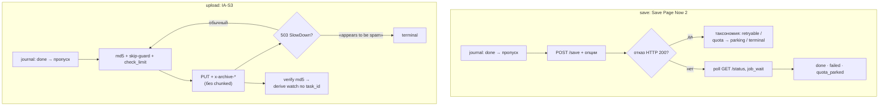

<div align="center">

# 📦 wauploader

**Сохранение страниц в web.archive.org и загрузка файлов в элементы archive.org**

Консольный инструмент на Go для батч-архивации: Save Page Now 2 для снимков страниц и IA-S3 для загрузки файлов в элементы. Только API, без эмуляции браузера; русский цветной TTY, `--json` для машин, журнал выполнения с продолжением работы через границы запусков.

[](https://go.dev/)
[](LICENSE)
[](https://web.archive.org/)
[](https://github.com/etcd-io/bbolt)

[](#-разработка)
[](docs/lint.md)
[](#-разработка)
[](../../releases)

[Возможности](#-возможности) · [Быстрый старт](#-быстрый-старт) · [Конфигурация](#️-конфигурация) · [Команды](#-команды) · [Коды выхода](#-коды-выхода) · [Безопасность](#️-безопасность) · [Как это работает](#-как-это-работает)

</div>

---

## 📑 Оглавление

- [⚡ Возможности](#-возможности)
- [🚀 Быстрый старт](#-быстрый-старт)
- [⚙️ Конфигурация](#️-конфигурация)
- [📖 Команды](#-команды)
- [🔁 Resume и журнал](#-resume-и-журнал)
- [🚦 Коды выхода](#-коды-выхода)
- [🛡️ Безопасность](#️-безопасность)
- [🌊 Как это работает](#-как-это-работает)
- [🌳 Структура проекта](#-структура-проекта)
- [🧪 Разработка](#-разработка)
- [📚 Ресёрч](#-ресёрч)

---

## ⚡ Возможности

- **Сохранение (SPN2)** — все 14 документированных опций Save Page Now 2 во флагах и конфиге: `capture_all`, `capture_outlinks`, `capture_screenshot`, `delay_wb_availability`, `force_get`, `skip_first_archive`, `outlinks_availability`, `email_result`, дедупликация `if_not_archived_within`, `js_behavior_timeout`, `capture_cookie`, `use_user_agent`, `target_username`/`target_password`.
- **Загрузка (IA-S3)** — файлы в элементы archive.org: один элемент (`--item`) или шаблон идентификатора на файл (`--identifier-from "custom-{{.Base}}"`), повторяемые метаданные `--meta ИМЯ=ЗНАЧЕНИЕ`, `--title`/`--description`, проверка MD5, наблюдение за деривацией.
- **Resume** — bbolt-журнал каждой цели; прерванный запуск продолжается следующим, а не начинается с нуля. Перебитая многогигабайтная загрузка безопасно начинается заново, остальные файлы элемента сохраняют своё состояние.
- **Отказоустойчивость** — полный разбор отказов SPN2 (отказ приходит и как HTTP 200 без `job_id`), таксономия ошибок `retryable / quota / terminal`, парковка задач до следующего дня по дневной квоте, retry-лестница с полным джиттером и учетом `Retry-After`, вежливость к сайтам-целям (лимит на хост).
- **Три режима вывода** — русский цветной TTY, обычный текст вне терминала (байт-в-байт), машинный `--json` (один JSON-объект на событие).
- **Конфигурация** — один TOML-файл, переменные окружения не читаются никогда; неизвестные ключи конфига вызывают предупреждение по имени.

---

## 🚀 Быстрый старт

### 1. Сборка

```sh
git clone https://github.com/4q4r/wauploader && cd wauploader
make build          # → ./wauploader (CGO_ENABLED=0, статический)
./wauploader version
```

### 2. Авторизация

```sh
./wauploader init
```

Интерактивно спросит email и пароль archive.org, обменяет их на ключи S3 и куки входа (эндпоинт `xauthn`) и запишет в `~/.config/wauploader/wauploader.toml` с правами 0600. Пароль не сохраняется. Ключи S3 можно вписать и вручную — они генерируются на <https://archive.org/account/s3.php>.

### 3. Первое сохранение

```sh
./wauploader save https://example.com https://example.org/page
./wauploader save --list urls.txt --if-not-archived-within "3d 5h 20m"
```

### 4. Первая загрузка

```sh
./wauploader upload dump.tar.gz \
  --item my-dump-2026 --collection test_collection --mediatype data \
  --title "Мой дамп" --verify --wait-derive
```

Коллекция и mediatype обязательны (флагами или в конфиге) — значений по умолчанию нет: инструмент не станет молча выбирать, куда положить файлы.

---

## ⚙️ Конфигурация

Один файл: `~/.config/wauploader/wauploader.toml` (путь меняется флагом `--config`). Переменные окружения **не читаются никогда**. Неизвестный ключ = предупреждение с именем ключа. Полностью аннотированный пример: [`docs/config-example.toml`](docs/config-example.toml).

| Секция | Ключ | По умолчанию | Описание |
| :-- | :-- | :-- | :-- |
| `[auth]` | `s3_access` + `s3_secret` | пусто | ключи IA-S3; задаются только вместе; обязательны для `upload` |
| `[auth]` | `cookie_user` + `cookie_sig` | пусто | куки входа; используются SPN2, когда ключей нет |
| `[spn2]` | `if_not_archived_within` | пусто (выкл) | дедупликация, форма IA timedelta: `"120"`, `"3d 5h 20m"` |
| `[spn2]` | `capture_all`, `capture_outlinks`, `capture_screenshot`, `delay_wb_availability`, `force_get`, `skip_first_archive`, `outlinks_availability`, `email_result` | `false` | опции SPN2 1:1 |
| `[spn2]` | `js_behavior_timeout` | `5` | тайм-аут JS-поведения, 0–30 сек (0 отключает JS) |
| `[spn2]` | `auth_mode` | `auto` | `auto` (ключи, если есть, иначе куки) / `keys` / `cookies` |
| `[upload]` | `collection` | — (обязателен) | коллекция элемента |
| `[upload]` | `mediatype` | — (обязателен) | `texts`, `etree`, `audio`, `movies`, `software`, `image`, `data`, `web` |
| `[upload]` | `queue_derive` | `true` | ставить деривацию в очередь |
| `[upload]` | `keep_old_version` | `true` | хранить прежние версии перезаписанных файлов |
| `[upload]` | `interactive_priority` | `false` | приоритетная очередь деривации |
| `[limits]` | `save_per_minute` | `5` | темп сохранений в минуту (серверный лимит: 7/мин) |
| `[limits]` | `save_concurrency` | `4` | параллельных сохранений |
| `[limits]` | `upload_concurrency` | `2` | параллельных загрузок |
| `[limits]` | `per_host_concurrency` | `3` | одновременных задач на один сайт-цель |
| `[limits]` | `job_wait` | `"20m"` | ожидание одной задачи (сохранение/деривация) |

---

## 📖 Команды

### Глобальные флаги

| Флаг | По умолчанию | Описание |
| :-- | :-- | :-- |
| `--config` | `~/.config/wauploader/wauploader.toml` | путь к файлу конфигурации |
| `--journal` | `~/.local/share/wauploader/journal.bbolt` | файл журнала (учитывает `XDG_DATA_HOME`) |
| `--json` | выкл | машинный вывод: один JSON-объект на событие или результат |
| `--no-color` | выкл | отключить цвет |
| `--dry-run` | выкл | показать действия, не трогая сеть и журнал (`save`, `upload`) |

### `wauploader save URL... | --list FILE`

| Флаг | Описание |
| :-- | :-- |
| `--list FILE` | цели по одной на строку, `#` — комментарии |
| `--force` | повторять цели, уже выполненные по журналу |
| `--capture-all`, `--capture-outlinks`, `--capture-screenshot`, `--delay-wb-availability`, `--force-get`, `--skip-first-archive`, `--outlinks-availability`, `--email-result` | опции SPN2 (см. конфиг выше) |
| `--if-not-archived-within N` | дедупликация: `"120"` или `"3d 5h 20m"` |
| `--js-behavior-timeout N` | 0–30 сек, 0 отключает JS |
| `--capture-cookie`, `--use-user-agent`, `--target-username`, `--target-password` | параметры запроса к сайту-цели (секреты нигде не выводятся) |

### `wauploader upload FILE... | --list FILE --item ID [--key NAME]`

| Флаг | Описание |
| :-- | :-- |
| `--item ID` | идентификатор элемента (взаимоисключим с `--identifier-from`) |
| `--identifier-from ШАБЛОН` | шаблон на файл, например `"custom-{{.Base}}"` |
| `--key NAME` | имя файла внутри элемента (только с `--item`) |
| `--collection`, `--mediatype` | обязательны, если не заданы в конфиге |
| `--meta ИМЯ=ЗНАЧЕНИЕ` | повторяемый флаг метаданных |
| `--title`, `--description` | название и описание элемента |
| `--no-derive` | не ставить деривацию в очередь |
| `--no-keep-old-version` | не хранить прежние версии файлов |
| `--interactive-priority` | приоритетная деривация |
| `--ignore-preexisting-bucket` | не проверять существование элемента перед созданием |
| `--verify` | проверить MD5 файлов после загрузки |
| `--wait-derive` | дождаться деривации (включает её постановку в очередь) |
| `--checksum-skip` | не пропускать файлы, уже лежащие в элементе с тем же MD5 |

### `wauploader status [JOB_ID | --user | --system]`

Статус одной задачи SPN2, сессии пользователя (`--user`) или службы (`--system`) — ровно один селектор.

### `wauploader jobs [--state failed|queued|pending|done] [--clear]`

Записи журнала; `--clear` удаляет отфильтрованные (без фильтра — все).

### `wauploader init` · `wauploader version`

Интерактивный вход по email+паролю с записью ключей в конфиг; версия сборки.

---

## 🔁 Resume и журнал

Журнал — файл bbolt `~/.local/share/wauploader/journal.bbolt` (путь переопределяют `XDG_DATA_HOME` и `--journal`). Каждая цель имеет состояние:

`queued → submitted → pending → done | failed | skipped | quota_parked`

- **Продолжение** — повторный запуск `save`/`upload` пропускает цели в `done` (`--force` вернёт их в работу) и подхватывает остальные с места остановки.
- **Квота** — цели, отложенные по дневной квоте SPN2 (`quota_parked`), сами не оживают: перечислите их явно в следующем запуске.
- **Прозрачность** — `wauploader jobs` показывает журнал; `--clear` чистит.
- **Прерванная загрузка** — частичный PUT не имеет докачки: файл начинается заново, соседи по элементу не страдают.

---

## 🚦 Коды выхода

| Код | Значение |
| :-- | :-- |
| `0` | всё выполнено |
| `1` | часть задач не выполнена: ошибки, парковка по квоте или прерывание |
| `2` | ошибка конфигурации или использования |
| `3` | ошибка авторизации archive.org |

---

## 🛡️ Безопасность

- **Пароль никогда не сохраняется.** `wauploader init` использует его один раз для обмена на ключи и куки и забывает: в конфиге и памяти его нет.
- **Файл конфигурации — 0600.** Запись идёт через временный файл с переименованием; права 0600 устанавливаются заново при каждой записи, что бы ни было в файле до этого.
- **Секреты не попадают в вывод.** Ключи и куки печатаются только маскированными (первые 4 символа + длина), в события `--json` и сообщения об ошибках не включаются никогда.
- **Переменные окружения не читаются.** Секреты не могут просочиться через env — только TOML-файл с правами 0600 и флаги командной строки.
- **Authorization ходит только на archive.org.** При цепочке редиректов (частые 307 у IA-S3) заголовок сохраняется только для `*.archive.org` и снимается на всех сторонних хостах.
- **Пароли сайтов-целей** (`--target-password`, `--capture-cookie`) существуют только как флаги и не записываются в журнал событий.

---

## 🌊 Как это работает



Запрос-поток сохранения:

1. Цели сливаются из аргументов и `--list` (взаимоисключимо), флаги перекрывают конфиг, конфиг валидируется (fail-fast, русский текст ошибки).
2. Журнал отсеивает выполненные цели — без `--force` они пропускаются.
3. Учётные данные разрешаются по `auth_mode`: ключи предпочитаются, куки — запас.
4. `POST /save` с опциями; отказ может прийти HTTP 200 с `{"status":"error"}` — тело всегда разбирается: `too-many-daily-captures` паркует цель до следующего дня, retryable-классы повторяются в рамках лестницы, терминальные фиксируются сразу.
5. Статус опрашивается до завершения; серверная задержка («Your capture will begin in NNs») уважается, `job_wait` ограничивает ожидание.
6. Итог печатается («сохранено · пропущено · отложено · ошибок»), процесс завершается кодом 0/1/2/3.

Запрос-поток загрузки:

1. Файлы разрешаются в `path → identifier/key`; идентификатор — из `--item` или из шаблона `--identifier-from` (данные — `{{.Base}}`).
2. `collection` и `mediatype` обязаны быть заданы — без значений по умолчанию.
3. Загрузка выполняется только ключами S3: куки IA-S3 не принимает; проверка — до хеширования, а не после 50 ГБ.
4. Skip-guard: файл, уже лежащий в элементе с тем же MD5 при отсутствии активных задач, пропускается (`--checksum-skip` отключает).
5. `PUT` с полным набором `x-archive-*`; `Transfer-Encoding: chunked` запрещён (требование IA-S3); обычный 503 SlowDown повторяет файл целиком, 503 «appears to be spam» — терминальный.
6. `--verify` сверяет MD5 ответа; `--wait-derive` наблюдает деривацию по baseline `task_id` из Tasks API в рамках `job_wait`.
7. Журнал и коды выхода — как у сохранения.

---

## 🌳 Структура проекта

```text
wauploader/
├── go.mod                   # модуль github.com/4q4r/wauploader, Go 1.27
├── go.sum                   # контрольные суммы зависимостей
├── LICENSE                  # MIT
├── main.go                  # вход: ExitError → коды выхода 0/1/2/3
├── Makefile                 # build · fmt · vet · lint · test · vuln · gate
├── .golangci.yml            # v2-конфиг линтера (см. docs/lint.md)
├── internal/
│   ├── version/             # имя, версия (ldflags), User-Agent
│   ├── config/              # TOML: загрузка, валидация, неизвестные ключи
│   ├── console/             # русский цветной TTY, глифы, FormatBytesRU
│   ├── httpx/               # HTTP/1.1, cookie jar, retry-лестница, 307-политика
│   ├── auth/                # разрешение кредов, xauthn-бустрап, запись 0600
│   ├── spn2/                # клиент SPN2 + таксономия ошибок
│   ├── ias3/                # IA-S3: x-archive-*, PUT, метаданные, деривация
│   ├── journal/             # bbolt-журнал: состояния, resume, очистка
│   ├── runner/              # пулы воркеров save/upload, лимитеры, события
│   └── commands/            # init · save · upload · status · jobs
└── docs/
    ├── plan.md              # план реализации (14 задач)
    ├── config-example.toml  # аннотированный пример конфигурации
    ├── lint.md              # пин линтера и лендмайн пары бинарник↔toolchain
    └── research/            # r1 SPN2 · r2 IA-S3 · r3 prior art · r4 libraries
```

---

## 🧪 Разработка

```sh
make help    # список целей
make gate    # ПОЛНЫЙ ГЕЙТ: fmt → vet → lint → test → vuln (каждый шаг — отдельная блокирующая команда)
```

| Цель | Что делает |
| :-- | :-- |
| `make build` | статический бинарник: `CGO_ENABLED=0 -trimpath -ldflags "-s -w"` + версия из `git describe` |
| `make fmt` | `gofmt -l -w` и `go vet ./...` |
| `make vet` | `go vet ./...` |
| `make lint` | `golangci-lint run` — гейт: 0 находок |
| `make test` | `go test -race -p 2 -count=1 ./...` (236 тестов, `GOTMPDIR` вне общего /tmp) |
| `make vuln` | `govulncheck ./...` |

Пин версии линтера и лендмайн «бинарник ↔ toolchain» — в [`docs/lint.md`](docs/lint.md). Тесты никогда не трогают живые сервисы: сеть эмулируется `httptest`-фальшаками.

---

## 📚 Ресёрч

Поведение инструмента основано на первоисточниках, проверенных ресёрчем (в [`docs/research/`](docs/research/)):

- **r1-spn2** — Save Page Now 2: опции, отказы HTTP 200, лимиты и квоты, статус-машина.
- **r2-ia-s3** — IA-S3: авторизация LOW, заголовки `x-archive-*`, 307-редиректы, SlowDown/spam, деривация.
- **r3-priorart** — разбор существующих клиентов и политика archive.org к ботам.
- **r4-libs** — выбор зависимостей (cobra, bbolt, go-toml/v2, mpb и др.) с обоснованием.

## Лицензия

[MIT](LICENSE) © 4q4r
