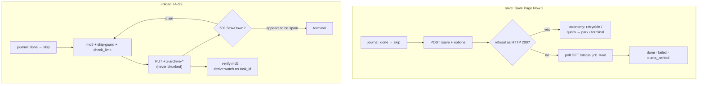

<div align="center">

# 📦 wauploader

**Save pages to web.archive.org and upload files to archive.org items**

Batch-archiving CLI written in Go: Save Page Now 2 (SPN2) for page captures, IA-S3 for file uploads. API-only — no browser emulation; a Russian colored TTY, `--json` for machines, and an execution journal that resumes work across runs.

[](https://go.dev/)
[](LICENSE)
[](https://web.archive.org/)
[](docs/research/r3-priorart-report.md)
[](https://github.com/etcd-io/bbolt)

[](#-development)
[](docs/lint.md)
[](#-development)
[](#-development)

[Features](#-features) · [Quick start](#-quick-start) · [Requirements](#-requirements--limitations) · [Configuration](#️-configuration) · [Commands](#-commands) · [Journal](#-journal--resume) · [Exit codes](#-exit-codes) · [Security](#️-security) · [How it works](#-how-it-works)

</div>

---

## 📑 Table of contents

- [⚡ Features](#-features)
- [🚀 Quick start](#-quick-start)
- [🔧 Requirements & limitations](#-requirements--limitations)
- [⚙️ Configuration](#️-configuration)
- [📖 Commands](#-commands)
- [🔁 Journal & resume](#-journal--resume)
- [🚦 Exit codes](#-exit-codes)
- [🛡️ Security](#️-security)
- [🌊 How it works](#-how-it-works)
- [🌳 Project layout](#-project-layout)
- [🧪 Development](#-development)
- [📦 Published with this tool](#-published-with-this-tool)
- [📚 Research notes](#-research-notes)

---

## ⚡ Features

- **Save (SPN2)** — all 14 documented Save Page Now 2 options as flags, 11 of them also as config keys: `capture_all`, `capture_outlinks`, `capture_screenshot`, `delay_wb_availability`, `force_get`, `skip_first_archive`, `outlinks_availability`, `email_result`, the dedup window `if_not_archived_within`, `js_behavior_timeout`, `capture_cookie`, `use_user_agent`, `target_username`/`target_password`.
- **Upload (IA-S3)** — files into archive.org items: one shared item (`--item`), a per-file identifier template (`--identifier-from "custom-{{.Base}}"`), a whole directory tree as one item with the tree preserved (`--key-from "{Path}"` plus a directory argument), or fully automatic PDF metadata (`--auto-meta`, needs poppler-utils); repeatable `--meta NAME=VALUE`, `--title`/`--description`, MD5 verification, and a derive watch.
- **Resume** — a bbolt journal per target: an interrupted run continues in the next one instead of starting over. An interrupted multi-gigabyte PUT safely restarts from byte 0, while the other files of the item keep their state.
- **Fault tolerance** — full parsing of SPN2 refusals (a refusal can arrive as HTTP 200 with `{"status":"error"}` and no `job_id`), a `retryable` / `quota` / `terminal` error taxonomy, parking of quota-exhausted targets until the next day, a retry ladder with full jitter that honors `Retry-After`, and per-host politeness toward the target sites.
- **Three output modes** — a Russian colored TTY, plain text outside a terminal (byte-for-byte), and machine-readable `--json` (one JSON object per event).
- **Configuration** — a single TOML file; environment variables are never read; an unknown config key produces a warning that names the key.
- **Russian console by design** — the human-facing output is in Russian. That is the tool's deliberate choice, not a rough edge. `--json` gives machines one object per event; the tool's own error strings stay Russian there too (the server's own messages and the JSON field names are not translated).

---

## 🚀 Quick start

### 1. Build

```sh
git clone https://github.com/4q4r/wauploader && cd wauploader
make build          # → ./wauploader (static binary, CGO_ENABLED=0)
./wauploader version
```

### 2. Authenticate

```sh
./wauploader init
```

Interactively asks for your archive.org email and password, exchanges them for S3 keys and login cookies through the `xauthn` endpoint, and writes them to `~/.config/wauploader/wauploader.toml` with mode 0600. The password is never stored. You can paste the S3 keys in by hand instead — they are generated at <https://archive.org/account/s3.php>.

### 3. Save your first pages

```sh
./wauploader save https://example.com https://example.org/page
./wauploader save --list urls.txt --if-not-archived-within "3d 5h 20m"
```

### 4. Upload your first files

```sh
./wauploader upload dump.tar.gz \
  --item my-dump-2026 --collection test_collection --mediatype data \
  --title "My dump" --verify --wait-derive
```

Collection and mediatype are mandatory (by flag or in the config) — there are no defaults: the tool never silently picks where your files land.

### 5. Review before the live run

```sh
./wauploader upload ./papers --item papers-2026 \
  --key-from "{Path}" --collection opensource --mediatype texts --dry-run
```

A dry run prints the whole plan — target, identifier, key, derived metadata — and touches neither the network nor the journal.

---

## 🔧 Requirements & limitations

- **Go 1.27+** to build; the produced binary is static (`CGO_ENABLED=0`, `-trimpath`) and needs no C library at runtime.
- **An archive.org account with S3 keys.** `wauploader init` fills them in; otherwise take them from <https://archive.org/account/s3.php>. Uploads always need the key pair — IA-S3 does not accept login cookies.
- **poppler-utils only for `--auto-meta`** (`pdfinfo` and `pdftotext` in `PATH`). Every other mode works without external binaries.
- **Collection access is per account.** Your account must be allowed to publish into the target collection. The items published with this tool went to `opensource` (texts) and `opensource_media` (data); `opensource_texts` was gated for the publishing account ("You lack sufficient privileges").
- **No resume inside a single large PUT.** IA-S3 has no resumable upload: a retried file is re-sent whole. The journal resumes the *batch*, not the byte offset of one file.
- **`--verify` can be too eager.** A file only shows up in the Item Metadata API after archive.org's ingest runs, so `--verify` retries a few times with short sleeps and then fails. With a short `job_wait` the verify budget runs out before the ingest lands — verify in a separate pass.
- **Archive.org derives asynchronously.** The derive is queued server-side by default; `--wait-derive` is what makes the tool wait for it.
- **A dry run still needs credentials.** The account is resolved before the dry-run branch, so `save --dry-run` and `upload --dry-run` exit with code 3 when no keys or cookies are configured.

---

## ⚙️ Configuration

One file: `~/.config/wauploader/wauploader.toml` (override the path with `--config`). Environment variables are **never** read. An unknown key produces a warning that names the key. A fully annotated example: [`docs/config-example.toml`](docs/config-example.toml).

| Section | Key | Default | Description |
| :-- | :-- | :-- | :-- |
| `[auth]` | `s3_access` + `s3_secret` | empty | IA-S3 keys; must be set together; required for `upload` |
| `[auth]` | `cookie_user` + `cookie_sig` | empty | login cookies; used by SPN2 when the keys are absent |
| `[spn2]` | `if_not_archived_within` | empty (off) | dedup window, IA timedelta form: `"120"`, `"3d 5h 20m"` |
| `[spn2]` | `capture_all`, `capture_outlinks`, `capture_screenshot`, `delay_wb_availability`, `force_get`, `skip_first_archive`, `outlinks_availability`, `email_result` | `false` | SPN2 options, 1:1 |
| `[spn2]` | `js_behavior_timeout` | `5` | JS behavior timeout in seconds, 0–30 (0 disables JS) |
| `[spn2]` | `auth_mode` | `auto` | `auto` (keys if present, else cookies) / `keys` / `cookies` |
| `[upload]` | `collection` | — (required) | collection the item belongs to |
| `[upload]` | `mediatype` | — (required) | `texts`, `etree`, `audio`, `movies`, `software`, `image`, `data`, `web` |
| `[upload]` | `queue_derive` | `true` | queue the derive after the upload |
| `[upload]` | `keep_old_version` | `true` | keep the previous versions of overwritten files |
| `[upload]` | `interactive_priority` | `false` | priority queue for the derive |
| `[limits]` | `save_per_minute` | `5` | saves per minute (server cap: 7/min) |
| `[limits]` | `save_concurrency` | `4` | parallel saves |
| `[limits]` | `upload_concurrency` | `2` | parallel uploads |
| `[limits]` | `per_host_concurrency` | `3` | concurrent jobs against one target host (max 5) |
| `[limits]` | `job_wait` | `"20m"` | how long to wait for one job (capture or derive) |

Fail-fast rules — the first violated one is reported and the run stops:

- `s3_access`/`s3_secret` must be set together, and `cookie_user`/`cookie_sig` must be set together.
- `auth_mode` accepts only `auto`, `keys`, `cookies`.
- `js_behavior_timeout` must be between 0 and 30; `if_not_archived_within` and `job_wait` must parse as IA timedelta (`"120"` = seconds, `"3d 5h 20m"` = units `d`, `h`, `m`, `s`, at most 100 years).
- `save_per_minute` ≥ 1, `save_concurrency` ≥ 1, `upload_concurrency` ≥ 1, `per_host_concurrency` between 1 and 5, `job_wait` > 0.
- Uploads require `collection` and `mediatype` — by flag or in the config; there is no default. `mediatype` must be one of the values above.
- An upload needs exactly one of `--item` / `--identifier-from`; `--key` and `--key-from` are only valid with `--item`.
- The file is written with mode 0600 by `wauploader init` (temp file + rename, permissions re-applied on every write).

---

## 📖 Commands

### Global flags

| Flag | Default | Description |
| :-- | :-- | :-- |
| `--config` | `~/.config/wauploader/wauploader.toml` | path to the configuration file |
| `--journal` | `~/.local/share/wauploader/journal.bbolt` | journal file (honors `XDG_DATA_HOME`) |
| `--json` | off | machine output: one JSON object per event or result |
| `--no-color` | off | disable terminal colors |
| `--dry-run` | off | show the actions without performing them — the network and the journal stay untouched (`save`, `upload`; a dry run prints in human-readable form, `--json` does not apply to it) |

Every command and subcommand answers to `-h` / `--help`.

### `wauploader save URL... | --list FILE`

| Flag | Description |
| :-- | :-- |
| `--list FILE` | targets, one per line; `#` starts a comment |
| `--force` | re-save targets the journal already marks as done (targets parked on quota are requeued on an explicit re-listing, with or without this flag) |
| `--capture-all` | SPN2 `capture_all`: save the full page content |
| `--capture-outlinks` | SPN2 `capture_outlinks`: save the links found on the page |
| `--capture-screenshot` | SPN2 `capture_screenshot`: take a screenshot of the page |
| `--delay-wb-availability` | SPN2 `delay_wb_availability`: delay the snapshot's appearance in Wayback |
| `--force-get` | SPN2 `force_get`: request the save even when a recent snapshot exists |
| `--skip-first-archive` | SPN2 `skip_first_archive`: skip the first archive request |
| `--outlinks-availability` | SPN2 `outlinks_availability`: check the availability of the links |
| `--email-result` | SPN2 `email_result`: send the result by email |
| `--if-not-archived-within N` | dedup window: `"120"` or `"3d 5h 20m"` |
| `--js-behavior-timeout N` | 0–30 seconds, 0 disables JS |
| `--capture-cookie` | SPN2 `capture_cookie`: cookie for the target site (secret, never printed) |
| `--use-user-agent` | SPN2 `use_user_agent`: User-Agent for the request to the target site |
| `--target-username` | SPN2 `target_username`: user name for the target site |
| `--target-password` | SPN2 `target_password`: password of the target site (secret, never printed) |

The 8 boolean SPN2 flags, `--if-not-archived-within` and `--js-behavior-timeout` map 1:1
onto the `[spn2]` config keys; a flag wins over the file. `--capture-cookie`,
`--use-user-agent`, `--target-username` and `--target-password` exist only as flags —
they carry secrets, so they never come from a file.

### `wauploader upload FILE... | DIR... | --list FILE --item ID [--key NAME | --key-from TEMPLATE]`

| Flag | Description |
| :-- | :-- |
| `--list FILE` | files, one path per line; `#` starts a comment |
| `--item ID` | archive.org item identifier (mutually exclusive with `--identifier-from`) |
| `--identifier-from TEMPLATE` | per-file identifier template, e.g. `"custom-{{.Base}}"` or `"papers-{{.BaseNoExt}}"` (mutually exclusive with `--item`) |
| `--key NAME` | file name inside the item (defaults to the file name; only with `--item`) |
| `--key-from TEMPLATE` | per-file key template (the file name inside the item): `{Path}` — path relative to the base dir, `{Name}` — name with extension, `{Base}` — name without extension, `{Ext}` — extension without the dot, `{Dir}` — relative directory, `{Abs}` — absolute path (informational only: a key must be relative, so `{Abs}` cannot be a key); requires `--item` |
| `--base-dir DIR` | base directory for the relative paths in `--key-from` (default: the common parent of the given targets) |
| `--include-hidden` | include hidden files and directories (`.`) when a directory is expanded (skipped by default; only with `--key-from`) |
| `--collection` | item collection (mandatory if not set in the config) |
| `--mediatype` | content type: `texts`, `etree`, `audio`, `movies`, `software`, `image`, `data` or `web` |
| `--meta NAME=VALUE` | item metadata, repeatable |
| `--title` | item title |
| `--description` | item description |
| `--no-derive` | do not queue the derive |
| `--no-keep-old-version` | do not keep the previous versions of overwritten files |
| `--interactive-priority` | priority queue for the derive |
| `--ignore-preexisting-bucket` | do not check whether the item exists before creating it |
| `--verify` | verify the MD5 of the uploaded files against the item metadata |
| `--wait-derive` | wait for the item's derive to finish (also turns the derive queueing on) |
| `--checksum-skip` | do not skip the files already present in the item with the same MD5 — the MD5-based skip is on by default, this flag turns it off |
| `--auto-meta` | derive each PDF's metadata from the file itself (see below) |
| `--identifier-scheme` | identifier scheme for `--auto-meta`; the only value is `dir-nn-slug`: `<dir>-<number>-<file-name>` |
| `--creator-source` | source of the `creator` values under `--auto-meta`: `file` — author from the file name (default), `pdf` — `Author` from the PDF, `both` — both values |

#### `--key-from`: a directory tree as one item

`--key-from` computes the file name inside the item **for every file** — so a whole
directory tree is uploaded into **one** archive.org item with the structure preserved:

```bash
wauploader upload ~/datasets/top-taganrog \
    --item taganrog-dataset-2026 \
    --key-from "{Path}" \
    --collection opensource --mediatype data --dry-run
```

The keys come out as `top-taganrog/001.json`, `top-taganrog/sub/002.json` — the
directory name survives, because the default base directory is the **common parent of
the given targets** (for a directory, its own parent; with no common parent — the
targets live in different roots — the filesystem root `/` is used). Set the base
directory explicitly to change that: `--base-dir ~/datasets` yields `001.json`,
`sub/002.json`. The base directory affects **only** `{Path}` and `{Dir}`.

The template is rendered once per file; the placeholders are `{Path}`, `{Name}`,
`{Base}`, `{Ext}`, `{Dir}`, `{Abs}` (the Go template form `{{.Path}}` takes the same
fields). `{Abs}` is informational: a key must be a **relative** path inside the item,
so a key that comes out absolute (a template built on `{Abs}` alone) is rejected —
use `{Path}`. A key is never normalized: an empty key, a `.` segment, a `..` segment
or an empty segment (an absolute path, a leading or doubled `/`) is a usage error, not
something to "repair" silently. The rules:

| Situation | Result |
| :-- | :-- |
| `--key-from` without `--item` | usage error (exit 2): the item must be named explicitly |
| `--key-from` together with `--key`, `--identifier-from`, `--identifier-scheme` or `--auto-meta` | usage error (exit 2) |
| `--base-dir` or `--include-hidden` without `--key-from` | usage error (exit 2): both flags work only with a key template |
| the template does not compile or names an unknown field | usage error (exit 2) with the template's own error text |
| the key is empty or contains a `..`, `.` or empty segment (an absolute path, a leading/doubled `/`) | usage error (exit 2) |
| two files produce the same key | usage error (exit 2): the second would overwrite the first |
| a directory in the arguments without `--key-from` | usage error (exit 2): a directory requires `--key-from` to preserve its structure |

A directory in the arguments is expanded recursively; **hidden files and directories**
(a path component starting with `.` — `.git`, `.env`, `.DS_Store`) are **skipped by
default**, so a tree with a repository in it does not fly off into the archive whole;
`--include-hidden` includes them. The directory named in the arguments is always
expanded, even when its own name starts with a dot — the hidden rule applies to the
entries inside the tree. The files go up in a deterministic order (by relative path),
the last file of the item queues the derive, and the first one creates the item with
the total size of the tree. `--dry-run` shows the per-file "path → identifier/key"
plan plus the template and base directory — run it before the live upload.

#### `--auto-meta`: metadata from the PDF itself

A batch upload of PDFs with automatic metadata: **1 PDF = 1 item**, everything in the
item is derived from the file itself. It requires
[poppler-utils](https://poppler.freedesktop.org/) (`pdfinfo`, `pdftotext`) in `PATH` —
without them the command fails with an explanation.

```bash
wauploader upload --auto-meta --identifier-scheme dir-nn-slug \
    --collection opensource --mediatype texts --dry-run ~/articles/athens/*.pdf
```

What is derived from the file:

| Field | Source |
| :-- | :-- |
| Identifier | `<dir>-<number>-<name>`: the parent directory name + the file's leading number (leading zeros stripped) + the rest of the name lowercased (non-alphanumeric runs become a hyphen); longer than 80 characters is cut at a word boundary |
| Title | the PDF `Title`; junk titles fall back to the human-readable topic from the file name: a hex placeholder like `<E2E5…>` (16+ hex digits, the `<>` wrapper optional), a layout/source file-name leak (ends with `.indb`/`.indd`/`.qxd`/`.docx`/`.doc`/`.pptx`/`.wpd`), an empty title; the `Microsoft Word - ` prefix is stripped (underscores → spaces) and a remainder of ≥4 characters becomes the title as-is |
| Creator | selected by `--creator-source`: `file` (default) — the author segment of the file name; `pdf` — `Author` from the PDF; `both` — the file-name author first, then the PDF `Author` as separate creator values |
| Year | the year from the PDF's `CreationDate` |
| Description | the first ~500 characters of the first page's text (whitespace collapsed, via `pdftotext`); a degenerate (empty first page) field is dropped |
| Subjects | the directory name + the topic words of the file name |
| Language | a first-page heuristic: `rus` at ≥30 % Cyrillic, `eng` when Latin dominates, otherwise the field is dropped |

Explicit flags override the derived metadata — per parameter: `--title` replaces the
derived title, `--description` the derived description; every name given through
`--meta` wins entirely for that name (e.g. `--meta subject=x` puts exactly `x` into
the subjects), while the derived fields you did not mention stay as they are.

File names must follow the `NN_author_topic_words.pdf` convention (e.g.
`01_schmitz_aristophanes_frogs.pdf`) — `NN` is mandatory, the second segment is the
author, the rest is the topic. A convention violation is an error with an
explanation. The directory name (the first part of the identifier) must be Latin: a
Cyrillic directory name does not fold into the allowed identifier characters, and the
derivation ends with an error. If two files of a directory produce one identifier
(e.g. `01_x.pdf` and `1_x.pdf` — the leading zeros are stripped), the run ends with an
error naming the conflicting files. `--item`, `--identifier-from`, `--key` and
`--key-from` are incompatible with `--auto-meta` (as is `--creator-source` outside
automatic metadata). Collection and mediatype are still mandatory (by flag or in the
config). `--dry-run` shows the full plan (identifier, title, creator, collection,
language, year, subjects, description head) and touches neither the network nor the
journal — run it before the live upload.

### `wauploader status [JOB_ID | --user | --system]`

The status of one SPN2 job, of the user session (`--user`) or of the service
(`--system`) — exactly one selector.

| Selector | Description |
| :-- | :-- |
| `JOB_ID` | the status of one SPN2 capture job |
| `--user` | the SPN2 session: how many jobs are available and how many are running |
| `--system` | the state of the SPN2 service |

### `wauploader jobs [--state failed|queued|pending|done] [--clear]`

The journal records; `--clear` deletes the filtered ones (all of them without a
filter). The listing is a human surface — `--json` does not apply to it.

| Flag | Description |
| :-- | :-- |
| `--state STATE` | filter by state: `failed`, `queued`, `pending` or `done` |
| `--clear` | delete the records matching the filter (all of them without a filter) |

### `wauploader init` · `wauploader version`

Interactive login with email + password that writes the keys into the config; the
build version.

---

## 🔁 Journal & resume

The journal is a bbolt file at `~/.local/share/wauploader/journal.bbolt` (the path is
overridden by `XDG_DATA_HOME` and by `--journal`). Every target has a state:

`queued → submitted → pending → done | failed | skipped | quota_parked`

- **Resume** — a second `save`/`upload` run skips the targets in `done` (`--force`
  puts the save targets back to work) and picks the rest up where the previous run
  stopped.
- **Quota** — targets parked on the SPN2 daily quota (`quota_parked`) do not wake up
  on their own: list them explicitly in the next run.
- **Transparency** — `wauploader jobs` shows the journal; `--clear` cleans it.
- **Interrupted upload** — a partial PUT has no resume: the file starts over, the
  other files of the item are unaffected.

---

## 🚦 Exit codes

| Code | Meaning |
| :-- | :-- |
| `0` | everything succeeded |
| `1` | some tasks did not run: errors, quota parking, an interruption — and a dry run that would skip journaled targets |
| `2` | configuration or usage error |
| `3` | archive.org authentication error |

---

## 🛡️ Security

- **The password is never stored.** `wauploader init` uses it once to exchange for keys and cookies and then drops it: it is in neither the config nor the process memory.
- **The config file is 0600.** Writes go through a temp file plus a rename; the 0600 mode is re-applied on every write, whatever the file held before.
- **Secrets never reach the output.** Keys and cookies are printed only masked (first 4 characters plus the length); they never appear in `--json` events or in error messages.
- **Environment variables are never read.** Secrets cannot leak in through the environment — only through the 0600 TOML file and the command-line flags.
- **Authorization only travels to archive.org.** Across a redirect chain (the frequent 307s of IA-S3) the header is kept only for `*.archive.org` and stripped on every third-party host.
- **Target-site passwords** (`--target-password`, `--capture-cookie`) exist only as flags and are never written to the event journal.
- **The archive.org-managed item files are never overwritten.** A PUT of `<id>_meta.xml` or `<id>_files.xml` is refused: it would corrupt the item's own metadata.
- **The User-Agent is descriptive.** Every request carries `wauploader/<version> (+https://github.com/4q4r/wauploader)`, as the archive.org bots policy asks; Go's default identifier is never sent.

---

## 🌊 How it works



Save request flow:

1. The targets are merged from the arguments and `--list` (mutually exclusive); the flags override the config; the config is validated fail-fast with a named error.
2. The journal filters out the finished targets — without `--force` they are skipped.
3. The credentials are resolved per `auth_mode`: the keys are preferred, the cookies are the fallback.
4. `POST /save` with the options; a refusal can arrive as HTTP 200 with `{"status":"error"}` — the body is always parsed: `too-many-daily-captures` parks the target until the next day, the retryable classes are retried inside the ladder, the terminal ones are recorded at once.
5. The status is polled until the job ends; a server-stated delay ("Your capture will begin in NNs") is honored, and `job_wait` bounds the wait.
6. The summary is printed ("saved · skipped · parked · failed"), and the process exits with 0/1/2/3.

Upload request flow:

1. The files are resolved into `path → identifier/key`; the identifier comes from `--item` or from the `--identifier-from` template (the data is `{{.Base}}` and `{{.BaseNoExt}}` — the name without the extension). With `--key-from` the key is computed per file (`{Path}`, `{Name}`, `{Base}`, `{Ext}`, `{Dir}`, `{Abs}`), and a directory in the arguments expands into a tree with the structure preserved (hidden files and directories are skipped unless `--include-hidden` is set).
2. `collection` and `mediatype` must be set — there are no defaults.
3. The upload runs on the S3 keys only: IA-S3 does not accept cookies; the check happens before the hashing, not after 50 GB.
4. Skip-guard: a file already lying in the item with the same MD5 and no active item tasks is skipped (`--checksum-skip` turns the skip off).
5. `PUT` with the full `x-archive-*` set; `Transfer-Encoding: chunked` is forbidden (an IA-S3 requirement); a plain 503 SlowDown re-sends the whole file, a 503 "appears to be spam" is terminal.
6. `--verify` compares the MD5 through the Item Metadata API; `--wait-derive` watches the derive against the baseline `task_id` from the Tasks API within `job_wait`.
7. The journal and the exit codes work as they do for saves.

---

## 🌳 Project layout

```text
wauploader/
├── go.mod                   # module github.com/4q4r/wauploader, Go 1.27
├── go.sum                   # dependency checksums
├── LICENSE                  # MIT
├── main.go                  # entry point: ExitError → exit codes 0/1/2/3
├── Makefile                 # build · fmt · vet · lint · test · vuln · check · gate
├── .golangci.yml            # linter v2 config (see docs/lint.md)
├── internal/
│   ├── version/             # name, version (ldflags), User-Agent
│   ├── config/              # TOML: load, validate, unknown keys
│   ├── console/             # Russian colored TTY, glyphs, FormatBytesRU
│   ├── httpx/               # HTTP/1.1, cookie jar, retry ladder, 307 policy
│   ├── auth/                # credential resolution, xauthn bootstrap, 0600 write
│   ├── spn2/                # SPN2 client + error taxonomy
│   ├── ias3/                # IA-S3: x-archive-*, PUT, metadata, derive
│   ├── journal/             # bbolt journal: states, resume, delete
│   ├── runner/              # save/upload worker pools, limiters, events
│   ├── pdfmeta/             # PDF metadata derivation (poppler-utils)
│   └── commands/            # init · save · upload · status · jobs
└── docs/
    ├── plan.md              # implementation plan
    ├── config-example.toml  # annotated configuration example
    ├── lint.md              # pinned linter + the binary↔toolchain landmine
    ├── upload-candidates.md # manifest of the upload candidates
    └── research/            # r1 SPN2 · r2 IA-S3 · r3 prior art · r4 libraries
```

---

## 🧪 Development

```sh
make help    # list the targets
make gate    # FULL GATE: check → vet → lint → test → vuln (each step is its own blocking command)
```

| Target | What it does |
| :-- | :-- |
| `make build` | static binary: `CGO_ENABLED=0 -trimpath -ldflags "-s -w"` plus the version from `git describe` |
| `make fmt` | `gofmt -l -w` and `go vet ./...` |
| `make vet` | `go vet ./...` |
| `make lint` | `golangci-lint run` — the gate is 0 findings |
| `make test` | `go test -race -p 2 -count=1 ./...` (329 tests, `GOTMPDIR` outside the shared `/tmp`) |
| `make vuln` | `govulncheck ./...` |
| `make check` | the formatting gate: `gofmt -l` must be empty |
| `make gate` | the full gate: check → vet → lint → test → vuln |

329 tests pass (282 test functions plus their subtests). The linter is golangci-lint
v2.14.0 with the `.golangci.yml` v2 schema (test files are excluded from the
analysis); `govulncheck` is v1.7.0. The pinned linter version and the "binary ↔
toolchain" landmine live in [`docs/lint.md`](docs/lint.md). The tests never touch the
live services: the network is emulated with `httptest` fakes.

The version string is stamped at build time (`-ldflags -X …/version.Version=…`);
`make build` takes it from `git describe`, which falls back to the short commit id
while the repository carries no release tag.

---

## 📦 Published with this tool

21 items were published with this tool on 2026-10-20 (15 Athens/Sparta papers, one
Wordstat keyword dataset, five third-party papers). The list is verifiable against
archive.org itself:

```sh
curl -s 'https://archive.org/advancedsearch.php?q=scanner%3A%22wauploader+0.1.0%22&fl%5B%5D=identifier&rows=50&output=json'
```

| Item | Collection | Mediatype |
| :-- | :-- | :-- |
| [athens-1-schmitz-aristophanes-frogs-reading-culture](https://archive.org/details/athens-1-schmitz-aristophanes-frogs-reading-culture) | `opensource` | `texts` |
| [athens-2-prokopyeva-kalokagathia](https://archive.org/details/athens-2-prokopyeva-kalokagathia) | `opensource` | `texts` |
| [athens-3-lambert-ephebic-monuments](https://archive.org/details/athens-3-lambert-ephebic-monuments) | `opensource` | `texts` |
| [athens-4-thomas-oral-tradition-written-record-athens](https://archive.org/details/athens-4-thomas-oral-tradition-written-record-athens) | `opensource` | `texts` |
| [athens-5-pritchard-sport-war-democratic-athens](https://archive.org/details/athens-5-pritchard-sport-war-democratic-athens) | `opensource` | `texts` |
| [athens-6-stroud-theozotides-orphans](https://archive.org/details/athens-6-stroud-theozotides-orphans) | `opensource` | `texts` |
| [athens-7-degg-paideia](https://archive.org/details/athens-7-degg-paideia) | `opensource` | `texts` |
| [athens-8-nagy-oath-of-the-ephebes](https://archive.org/details/athens-8-nagy-oath-of-the-ephebes) | `opensource` | `texts` |
| [sparta-1-pechatnova-gerousia-gerontocracy](https://archive.org/details/sparta-1-pechatnova-gerousia-gerontocracy) | `opensource` | `texts` |
| [sparta-2-cartledge-literacy-spartan-oligarchy](https://archive.org/details/sparta-2-cartledge-literacy-spartan-oligarchy) | `opensource` | `texts` |
| [sparta-3-pechatnova-spartan-agon](https://archive.org/details/sparta-3-pechatnova-spartan-agon) | `opensource` | `texts` |
| [sparta-4-clark-spartan-women](https://archive.org/details/sparta-4-clark-spartan-women) | `opensource` | `texts` |
| [sparta-5-nafissi-whip-agones-orthia](https://archive.org/details/sparta-5-nafissi-whip-agones-orthia) | `opensource` | `texts` |
| [sparta-6-darwin-spartan-kings-ephors](https://archive.org/details/sparta-6-darwin-spartan-kings-ephors) | `opensource` | `texts` |
| [sparta-7-pechatnova-gerontokratia-plato](https://archive.org/details/sparta-7-pechatnova-gerontokratia-plato) | `opensource` | `texts` |
| [intrieri-philia-interstatale-isocrate-2021](https://archive.org/details/intrieri-philia-interstatale-isocrate-2021) | `opensource` | `texts` |
| [gomez-mendoza-deporte-universitario-uaemex-2023](https://archive.org/details/gomez-mendoza-deporte-universitario-uaemex-2023) | `opensource` | `texts` |
| [leshkevich-filosofia-nauki-2001](https://archive.org/details/leshkevich-filosofia-nauki-2001) | `opensource` | `texts` |
| [moelcnik-frauenrollen-sparta-athen-2021](https://archive.org/details/moelcnik-frauenrollen-sparta-athen-2021) | `opensource` | `texts` |
| [levy-remarques-preliminaires-education-spartiate-1997](https://archive.org/details/levy-remarques-preliminaires-education-spartiate-1997) | `opensource` | `texts` |
| [wordstat-evakuator-results-2026](https://archive.org/details/wordstat-evakuator-results-2026) | `opensource_media` | `data` |

The dataset item holds the Wordstat keyword-export tree with the directory structure
preserved as nested item keys. The 62 `*.error-403.json` dumps of the original tree
were left out — the published item contains only the collected data.

---

## 📚 Research notes

The tool's behavior is based on primary sources checked by research (in
[`docs/research/`](docs/research/)):

- **r1-spn2** — Save Page Now 2: the options, the HTTP 200 refusals, the limits and quotas, the status machine.
- **r2-ia-s3** — IA-S3: the LOW authorization, the `x-archive-*` headers, the 307 redirects, SlowDown/spam, the derive.
- **r3-priorart** — a review of the existing clients and of archive.org's policy towards bots.
- **r4-libs** — the dependency selection (cobra, bbolt, go-toml/v2, x/term, x/time, x/sync) with the reasoning.

## License

[MIT](LICENSE) © 4q4r
